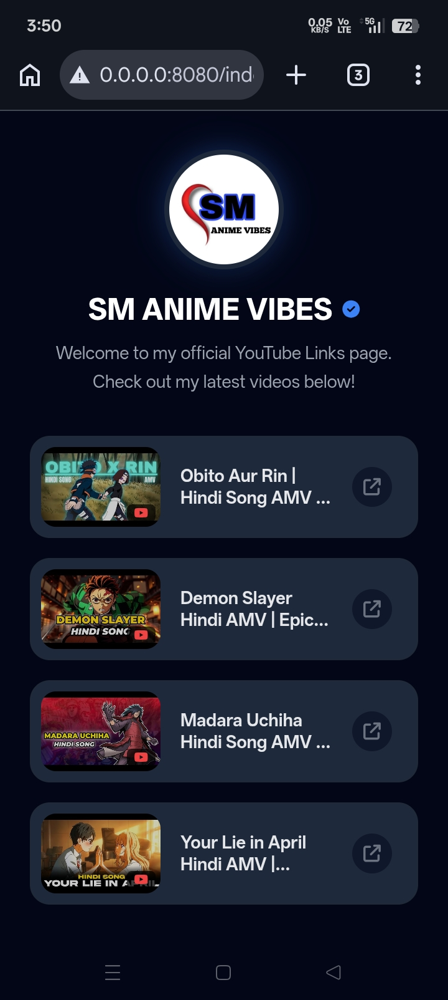
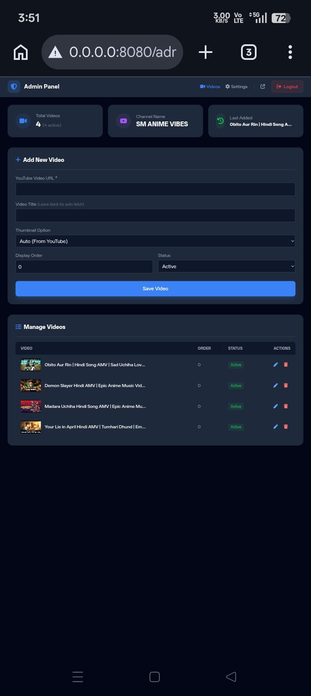
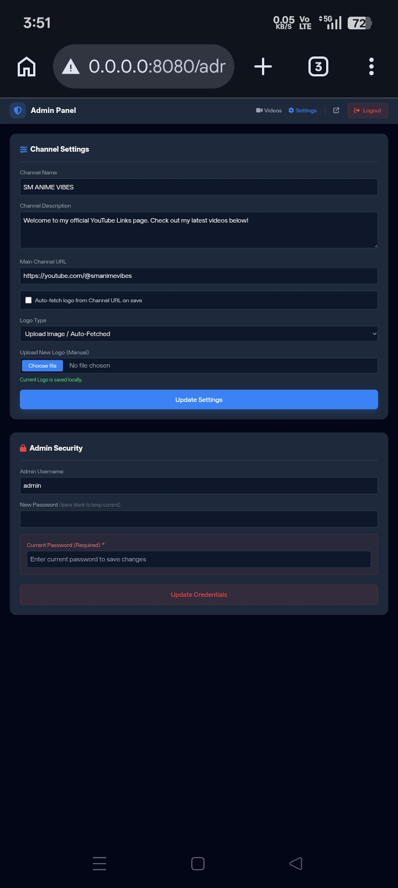

# YouTube Linktree PHP

A free, mobile-first Linktree-style bio link page for YouTube creators, built with PHP, MySQL and Tailwind CSS. Put all your YouTube videos and channel links on one dark, app-like page and manage everything from a secure admin panel. Works on free shared hosting like InfinityFree. No Composer, no frameworks.

**Live demo:** https://smanimevibes.page.gd/

---

## Screenshots

**Public page**

**Admin dashboard**

**Settings**

---

## Features

### Public page (Linktree style)
- Mobile-first dark theme (AMOLED friendly, Tailwind CSS)
- Clickable channel logo and name that open your YouTube channel
- Video cards with thumbnails, rounded corners and hover glow
- Smart ordering: custom display order, newest first

### Admin panel
- Add, edit, delete and reorder your YouTube video links
- Auto-fetch video titles from YouTube (oEmbed, no API key needed)
- Channel logo auto-fetch from your YouTube channel page, with manual upload or image URL as fallback
- Settings panel for channel name, description, URL, logo and admin credentials
- Secure image uploads: real-image check (getimagesize), server-side extension, random filenames, 5 MB limit

### Security
- Prepared statements everywhere (no SQL injection)
- CSRF tokens on all admin forms, including delete
- Login brute-force lock: 5 failed tries = 5 minute lock
- Passwords hashed with `password_hash()`
- Hardened session cookies (HttpOnly, SameSite=Lax, Secure on HTTPS)
- Database errors logged, never shown to visitors
- `upload/.htaccess` blocks PHP execution in the uploads folder
- Logo fetch restricted to YouTube and Google image hosts (SSRF safe)

---

## Tech stack

PHP 8+, MySQL/MariaDB (mysqli), Tailwind CSS (CDN). No framework, no Composer, no Node.

## Requirements

Any shared hosting with PHP 8+ and one MySQL database. Tested on InfinityFree free hosting.

## Installation

Full guide with InfinityFree steps: [docs/INSTALL.md](docs/INSTALL.md)

Quick version:
1. Upload all files to your hosting (`htdocs/`).
2. Create a MySQL database and import `database.sql` (phpMyAdmin).
3. Copy `config.sample.php` to `common/config.php` and fill in your DB details.
4. Open `yourdomain.com/admin`, log in with `admin` / `admin123`.
5. Change the admin password immediately (Settings > Security).
6. Turn on Force HTTPS in your hosting panel.

## Configuration

`common/config.php` (never commit this file):

| Constant | What it is |
|---|---|
| `DB_HOST` | MySQL host from your hosting panel |
| `DB_USER` | MySQL username |
| `DB_PASS` | MySQL password |
| `DB_NAME` | MySQL database name |
| `GA_MEASUREMENT_ID` | Optional Google Analytics 4 ID (`G-XXXXXXX`). Empty = no analytics code on the page |

## FAQ

**Is this a free Linktree alternative?**
Yes. It is a self-hosted Linktree-style link-in-bio page focused on YouTube creators, and it is free and open source (MIT).

**Can I host it on InfinityFree or other free hosting?**
Yes, that is the main target. Any PHP + MySQL shared hosting works. No VPS, Composer or SSH needed.

**Does it need Composer or a framework?**
No. Plain PHP files, upload and run.

**How do I change the admin password?**
Log in at `/admin`, go to Settings > Security. You need your old password to set a new one.

**How does the channel logo auto-fetch work?**
The admin panel reads the `og:image` of your YouTube channel page, validates the image, and stores it locally. If auto-fetch fails, you can upload a logo or paste an image URL instead.

**How do I add Google Analytics?**
Put your GA4 Measurement ID in `GA_MEASUREMENT_ID` in `common/config.php`. Leave it empty to disable analytics.

## Roadmap

- Multiple themes
- Click stats per video
- Multi-channel support

## Contributing

Beginners welcome. See [CONTRIBUTING.md](CONTRIBUTING.md).

## Security

Found a vulnerability? Please read [SECURITY.md](SECURITY.md). Do not open a public issue for security problems.

## License

MIT - see [LICENSE](LICENSE). Free to use, modify and share, with credit.

## Credits

Built by [Shiva Miri](https://github.com/shivamiri). Live at [smanimevibes.page.gd](https://smanimevibes.page.gd/).
